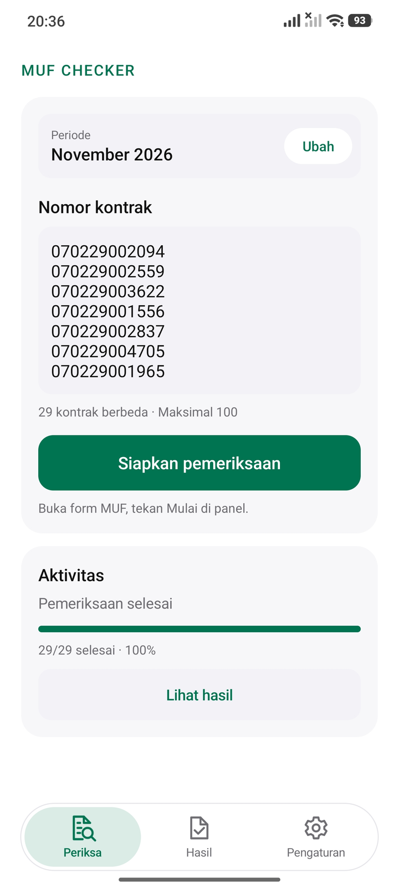
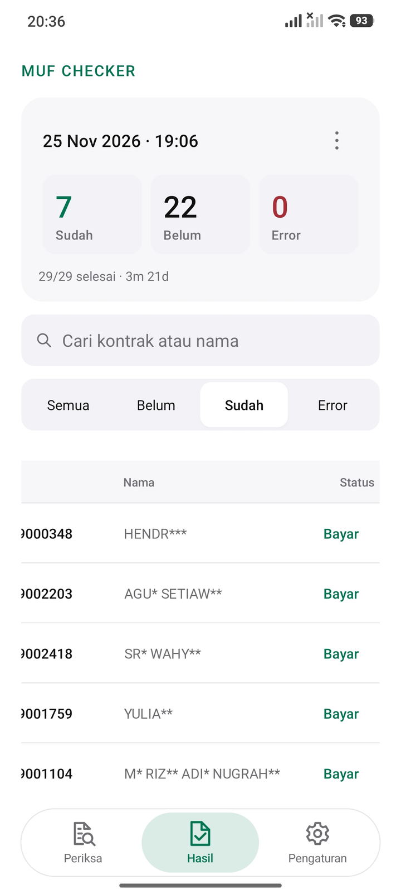
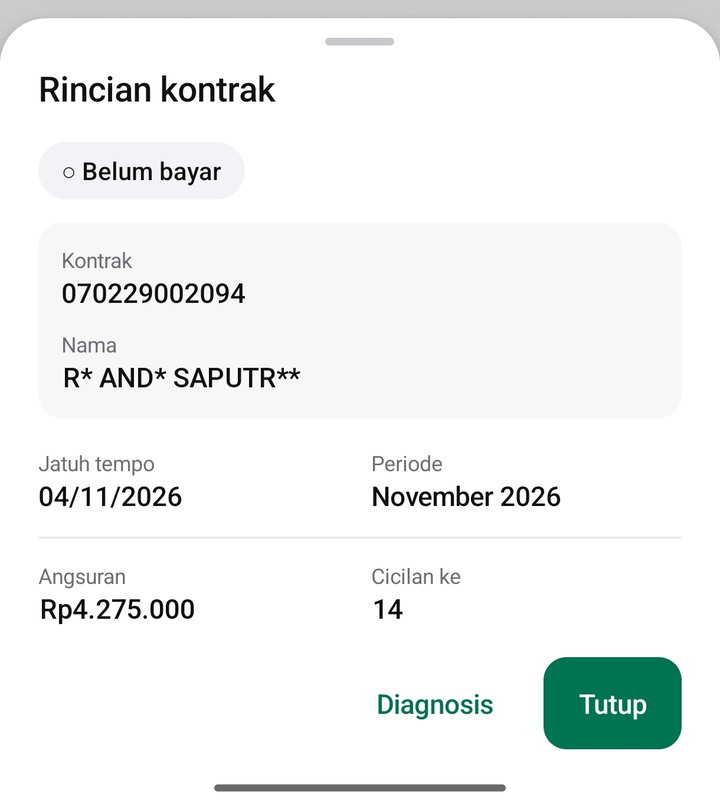
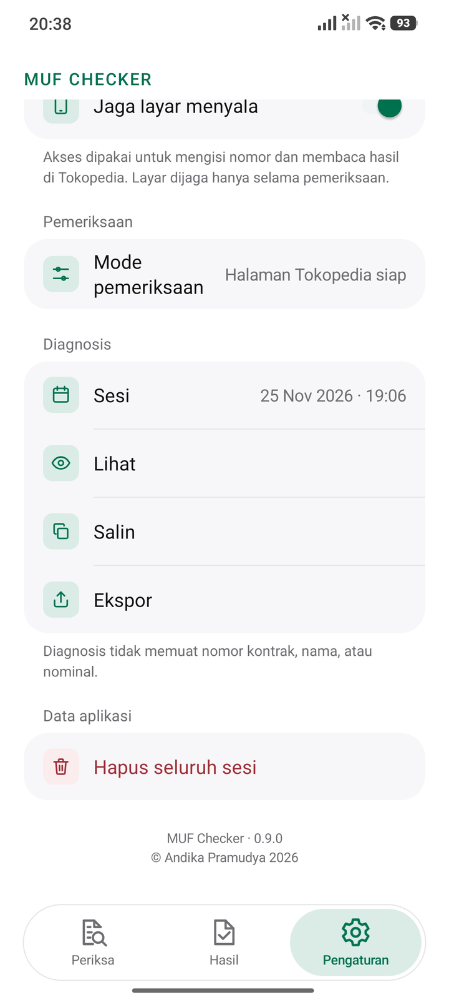

<h1 align="center">MUF Checker</h1>

<p align="center">
  Aplikasi Android untuk memeriksa indikasi status angsuran Mandiri Utama Finance (MUF)<br />
  secara massal melalui aplikasi Tokopedia di ponsel sendiri.
</p>

<p align="center">
  
  
  
  
  
</p>

<p align="center">
  <a href="#mulai-cepat">Mulai cepat</a> ·
  <a href="#cara-penggunaan">Penggunaan</a> ·
  <a href="#arti-hasil">Arti hasil</a> ·
  <a href="#tanya-jawab-dan-pemecahan-masalah">Tanya jawab</a> ·
  <a href="#privasi-dan-keamanan">Privasi</a> ·
  <a href="CHANGELOG.md">Catatan rilis</a>
</p>

---

<table align="center">
  <tr>
    <td align="center"></td>
    <td align="center"></td>
    <td align="center"></td>
    <td align="center"></td>
  </tr>
  <tr>
    <td align="center"><b>Periksa</b><br /><sub>Periode dan daftar kontrak</sub></td>
    <td align="center"><b>Hasil</b><br /><sub>Ringkasan, cari, dan filter</sub></td>
    <td align="center"><b>Rincian kontrak</b><br /><sub>Detail per kontrak</sub></td>
    <td align="center"><b>Pengaturan</b><br /><sub>Diagnosis ringkas</sub></td>
  </tr>
</table>

<p align="center"><sub>Diuji pada Poco X7 (Xiaomi 24095PCADG) · Android 16 / HyperOS · Tokopedia 45.4.5. Nomor kontrak, nama, dan nominal pada gambar adalah data contoh yang telah disamarkan. Gambar Pengaturan menampilkan kartu Diagnosis versi 0.9.1.</sub></p>

> [!IMPORTANT]
> Hasil MUF Checker adalah **indikasi operasional**, bukan bukti transaksi atau konfirmasi pembayaran resmi dari MUF maupun Tokopedia. Aplikasi ini adalah alat bantu internal dan **bukan** produk resmi keduanya. Gunakan hanya untuk nomor kontrak yang memang menjadi kewenangan Anda.

## Ringkasan

MUF Checker membantu memeriksa hingga 100 nomor kontrak MUF dalam satu sesi tanpa mengetik satu per satu. Aplikasi bekerja melalui layanan Aksesibilitas Android pada aplikasi Tokopedia yang sudah login di ponsel Anda: nomor kontrak diisi ke form *Angsuran Kredit → Mandiri Utama Finance*, tanggal jatuh tempo yang tampil dibaca, lalu aplikasi menyimpulkan apakah angsuran pada periode yang dipilih **sudah** atau **belum** dibayar.

Semua hasil tersimpan di perangkat, dapat dicari dan difilter, dan tidak pernah dikirim ke server mana pun.

## Fitur utama

| | |
| --- | --- |
| **Antrean massal** | Hingga 100 kontrak per sesi. Nol di depan dipertahankan dan nomor duplikat otomatis diabaikan. |
| **Kendali penuh** | Pemeriksaan baru berjalan setelah Anda menekan **Mulai** pada panel mengambang. Tersedia **Jeda**, **STOP**, dan **Lanjutkan**. |
| **Hasil yang jelas** | Ringkasan Sudah, Belum, dan Error, pencarian nomor atau nama, filter status, serta rincian per kontrak. |
| **Aman saat gagal** | Pesan seperti pembatasan cabang atau kontrak tidak ditemukan dicatat sebagai ERROR apa adanya, tidak pernah dianggap lunas maupun belum bayar. |
| **Tersimpan otomatis** | Hasil disimpan secara atomik sebelum antrean pindah ke kontrak berikutnya, sehingga tidak hilang saat aplikasi tertutup. |
| **Diagnosis tanpa data pribadi** | Laporan diagnosis `.txt` dapat dilihat, disalin, atau diekspor tanpa nomor kontrak, nama, maupun nominal. |

## Mulai cepat

### Persyaratan

- Ponsel Android 8.0 (API 26) atau lebih baru.
- Aplikasi Tokopedia yang sudah login dengan akun sendiri. MUF Checker tidak pernah mengisi sandi, PIN, atau OTP.

### 1. Pasang aplikasi

1. Buka halaman **[Releases](../../releases/latest)** dan unduh berkas `MUF-Checker-<versi>.apk`.
2. Buka berkas APK tersebut. Bila diminta, izinkan **Instal aplikasi tidak dikenal** untuk aplikasi pengelola file atau browser yang Anda pakai.
3. Jika versi lama sudah terpasang, pilih **Perbarui**. Jangan mencopot versi lama, supaya riwayat sesi tetap ada.

<details>
<summary>Memeriksa keaslian APK (opsional)</summary>

Setiap rilis menyertakan `SHA256SUMS.txt`. Cocokkan nilainya dengan:

```powershell
Get-FileHash .\MUF-Checker-<versi>.apk -Algorithm SHA256
```

Pembaruan hanya dapat dipasang bila APK ditandatangani dengan kunci yang sama dengan versi yang sudah terpasang.
</details>

### 2. Aktifkan Aksesibilitas

1. Buka **Setelan → Aksesibilitas → Aplikasi yang diunduh → MUF Checker**, lalu aktifkan.
2. Pada HyperOS/MIUI dan Android 13 ke atas, sakelar bisa berwarna abu-abu dengan pesan *Setelan terbatas*. Buka **Setelan → Aplikasi → MUF Checker**, ketuk menu **⋮** di pojok kanan atas, pilih **Izinkan setelan terbatas**, lalu ulangi langkah 1.
3. Status akses dapat dicek di tab **Pengaturan** pada MUF Checker.

### 3. Lakukan pemeriksaan pertama

Sebelum memeriksa banyak kontrak, coba dulu **lima kontrak yang statusnya sudah Anda ketahui** untuk memastikan hasilnya cocok di ponsel Anda.

## Cara penggunaan

1. Buka tab **Periksa**, ketuk **Ubah** untuk memilih bulan dan tahun periode.
2. Tempel nomor kontrak, satu per baris (8–20 angka). Jumlah kontrak berbeda tampil di bawah kolom.
3. Ketuk **Siapkan pemeriksaan**. Aplikasi beralih ke Tokopedia. Buka *Top-up & Tagihan → Angsuran Kredit → Mandiri Utama Finance*.
4. Setelah form terverifikasi, tekan **Mulai** pada panel mengambang. Biarkan Tokopedia tetap di layar sampai selesai.
5. Kembali ke MUF Checker dan buka tab **Hasil** untuk melihat ringkasan, mencari kontrak atau nama, memfilter status, dan membuka rincian.

<details>
<summary>Kontrol antrean</summary>

- **Jeda** menyelesaikan kontrak yang sedang diperiksa, lalu berhenti.
- **STOP** berhenti segera. Kontrak yang belum selesai kembali menunggu.
- **Lanjutkan** menyiapkan panel untuk kontrak yang belum selesai. Hasil yang sudah sukses tidak diperiksa ulang.
- **Coba ulang ERROR** hanya dijalankan bila Anda memilihnya. Tidak ada pemeriksaan ulang otomatis.
- **Batal** sebelum Mulai mengembalikan form agar dapat diedit lagi.
- Antrean yang sudah mulai diperiksa tidak dapat ditimpa sesi baru.
- Sesi lama dapat dipilih atau dihapus melalui menu **⋮** di tab Hasil. Sesi yang sedang berjalan dilindungi.
</details>

<details>
<summary>Pengaturan</summary>

| Bagian | Isi |
| --- | --- |
| Akses | Status Aksesibilitas dan **Jaga layar menyala** (layar hanya dijaga selama pemeriksaan). |
| Pemeriksaan | Ketuk **Mode pemeriksaan** untuk melihat dan memilih mode: *Halaman Tokopedia siap* (bawaan) atau melalui tautan MUF. |
| Diagnosis | Ketuk baris **Sesi** untuk memilih sesi. Tiga tombol ikon di bawahnya: 👁 **Lihat**, ⧉ **Salin**, dan ⇧ **Ekspor** laporan diagnosis `.txt` (tekan lama untuk melihat namanya). Ekspor sesi aktif memerlukan Jeda terlebih dahulu. |
| Data aplikasi | **Hapus seluruh sesi** dari perangkat. |
</details>

## Arti hasil

| Jatuh tempo dibanding periode terpilih | Status |
| --- | --- |
| Setelah periode | ✓ Sudah bayar |
| Sama dengan atau sebelum periode | ○ Belum bayar |
| Inquiry, tanggal, atau identitas tidak terverifikasi | ! Error |
| Pesan pembayaran dibatasi atau diminta menghubungi cabang | ! Error, pembatasan cabang |

`Bayar` pada tabel Hasil adalah label ringkas untuk *Sudah bayar*. Status didasarkan pada asumsi bahwa tanggal **Jatuh tempo** di Tokopedia menunjukkan angsuran berikutnya yang belum dibayar. Tanggal sumber tidak diubah, dan nilai angsuran diambil dari tagihan di luar biaya admin. Nama yang tampil berbintang disimpan sesuai sumber; aplikasi tidak menebak huruf yang disembunyikan.

## Tanya jawab dan pemecahan masalah

<details>
<summary><b>Sakelar Aksesibilitas tidak bisa diaktifkan</b></summary>

Ikuti langkah *Izinkan setelan terbatas* pada [Aktifkan Aksesibilitas](#2-aktifkan-aksesibilitas). Pada HyperOS, pastikan juga MUF Checker tidak dibatasi oleh penghemat baterai (Setelan → Aplikasi → MUF Checker → Penghemat baterai → *Tanpa batasan*).
</details>

<details>
<summary><b>Tombol Mulai tidak aktif</b></summary>

Panel menunggu form MUF terverifikasi. Pastikan halaman yang terbuka adalah *Angsuran Kredit* dengan penyedia **Mandiri Utama Finance** dan kolom nomor kontrak terlihat di layar.
</details>

<details>
<summary><b>Pemeriksaan berhenti sendiri</b></summary>

Antrean otomatis dijeda bila Tokopedia meminta login atau verifikasi, layar padam, layanan Aksesibilitas terputus, atau terjadi dua kegagalan teknis berturut-turut. Selesaikan penyebabnya, lalu tekan **Lanjutkan**.
</details>

<details>
<summary><b>Banyak hasil ERROR “Tidak ada respons”</b></summary>

Biasanya karena koneksi lambat atau Tokopedia belum selesai memuat. Pastikan sinyal stabil, lalu gunakan **Coba ulang ERROR**. Jika berlanjut, kirim laporan diagnosis (Pengaturan → Diagnosis → Ekspor) kepada pengelola aplikasi.
</details>

<details>
<summary><b>Pembaruan gagal dipasang</b></summary>

Pembaruan hanya berhasil bila APK ditandatangani dengan kunci yang sama. Unduh APK hanya dari halaman Releases repositori ini.
</details>

## Perangkat yang sudah diuji

| Perangkat | Android | Tokopedia | MUF Checker | Catatan |
| --- | --- | --- | --- | --- |
| Poco X7 (Xiaomi 24095PCADG) | 16 / HyperOS | 45.4.5 | 0.9.0 | 29 kontrak, 3 menit 21 detik |
| Emulator Android (API 36) | 16 | – | 0.9.1 | Tata letak Pengaturan dan tooltip tombol Diagnosis |

Pengujian emulator dan UI tidak menggantikan validasi langsung di Tokopedia. Setelah memasang versi baru, cocokkan dulu beberapa kontrak yang diketahui sebelum memeriksa antrean besar.

## Keandalan

- Penyedia MUF dan nomor kontrak diverifikasi persis sebelum satu ketukan *Bayar*.
- Maksimal dua kali pengisian dan satu inquiry per kontrak, dengan pengecekan kecocokan identitas, label Jatuh tempo, dan dua pembacaan stabil minimal 400 ms.
- Penantian hasil atau rincian dibatasi 25 detik. Form yang diam setelah inquiry dibatasi 10 detik pengamatan dan dicatat sebagai ERROR “Tidak ada respons”.

## Privasi dan keamanan

- Data tersimpan di penyimpanan privat perangkat, dan pencadangan Android dinonaktifkan.
- Aplikasi **tidak** meminta izin `INTERNET`. Tidak ada server, iklan, analitik, OCR, maupun API internal MUF atau Tokopedia. Komunikasi inquiry dilakukan oleh aplikasi Tokopedia sendiri.
- Aplikasi tidak memilih metode pembayaran dan tidak pernah mengonfirmasi pembayaran.
- Laporan diagnosis tidak memuat nomor kontrak, nama, atau nominal.

Rincian lengkap ada di [PRIVACY.md](PRIVACY.md).

> [!NOTE]
> Contoh nomor kontrak di dokumentasi, gambar, dan pengujian memakai pola tahun **29** (misalnya `070229001234`) agar tidak menunjuk ke kontrak nyata.

## Untuk pengembang

<details>
<summary>Struktur repositori</summary>

| Direktori | Isi |
| --- | --- |
| `app/` | Aplikasi Android native (`id.local.mufchecker`). |
| `tests/` | Pengujian Java/host dan instrumentasi Android dengan data sintetis. |
| `scripts/` | Skrip build Android dan APK smoke test. |
| `docs/screenshots/` | Gambar tampilan untuk README (data contoh). |
| `web/` | Dashboard PWA React dan add-on Firefox (eksperimental, perlu kalibrasi). Lihat [`web/README.md`](web/README.md). |
</details>

<details>
<summary>Build dan pengujian Android</summary>

Kebutuhan: PowerShell 7, JDK 17+, Android SDK Platform 36, dan Build Tools 36.0.0.

```powershell
.\scripts\build.ps1 -Unsigned
```

Untuk APK yang dapat dipasang sebagai pembaruan, atur `MUF_KEYSTORE`, `MUF_STORE_PASSWORD`, dan bila perlu `MUF_KEY_ALIAS` (bawaan `prototype`), lalu jalankan `.\scripts\build.ps1` tanpa `-Unsigned`. Build berhenti bila kunci tidak ditemukan dan tidak membuat kunci pengganti. Keystore, kredensial, APK, dan hasil pemeriksaan tidak boleh di-commit.

Build menjalankan pemeriksaan Java host, kompilasi resource dan Java, dex, zipalign, signing, verifikasi signature, serta SHA-256. Instrumentasi Android dibangun terpisah dan tidak masuk ke APK produk:

```powershell
.\scripts\build-android-smoke.ps1
```

Seed instrumentasi hanya boleh dijalankan pada emulator dengan instalasi kosong.
</details>

<details>
<summary>Dashboard dan add-on Firefox</summary>

Kebutuhan: Node.js 22+ dan pnpm 10.

```sh
cd web
pnpm install --frozen-lockfile
pnpm check     # lint, typecheck, test, build
```
</details>

## Dokumentasi

| Dokumen | Isi |
| --- | --- |
| [CHANGELOG.md](CHANGELOG.md) | Riwayat perubahan per versi |
| [PRIVACY.md](PRIVACY.md) | Data yang disimpan dan yang tidak |
| [web/README.md](web/README.md) | Dashboard dan add-on Firefox |

---

<p align="center"><sub>© 2026 Andika Pramudya · Alat bantu internal, tidak berafiliasi dengan Mandiri Utama Finance maupun Tokopedia.</sub></p>
